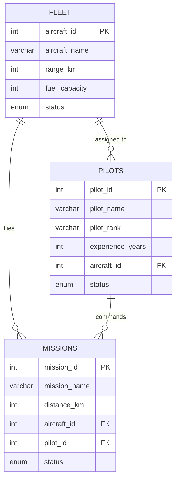

# AeroManage

**A Flask + MySQL aviation management system for aircraft fleets, pilots and missions.**

AeroManage is a **college mini-project for the Database Management Systems (DBMS) course**. It pairs
a normalised MySQL schema with a Flask web application, demonstrating relational design, foreign
keys, joins, aggregation and transactional state updates on a realistic aviation-management domain.

---

## Features

- **System dashboard** — fleet size, mission counts, aircraft availability, total fuel capacity and
  active pilots, all computed with SQL aggregate queries.
- **Fleet management** — add aircraft (name, range, fuel capacity) and remove them.
- **Pilot management** — register pilots with rank and experience, assign them to an aircraft, and
  search by name.
- **Mission planning** — create a mission with a distance, aircraft and pilot; the app marks both
  resources as busy inside a single transaction.
- **Mission completion** — completing a mission releases the aircraft and pilot back to `Available`.
- **Session login** — a simple session-based gate in front of every management page.

---

## Tech stack

| Layer     | Technology                                  |
| --------- | ------------------------------------------- |
| Front end | HTML templates (Jinja2) + hand-written CSS   |
| Back end  | Python 3 · Flask                             |
| Database  | MySQL 8 (via `mysql-connector-python`)       |
| Config    | `python-dotenv` + environment variables      |

---

## Database design

Three related tables in the `aero` database:



**Constraints and behaviour**

- `fleet.aircraft_id`, `pilots.pilot_id`, `missions.mission_id` are auto-increment primary keys.
- `pilots.aircraft_id`, `missions.aircraft_id` and `missions.pilot_id` are foreign keys with
  `ON DELETE SET NULL` and `ON UPDATE CASCADE`.
- `status` columns are `ENUM`s, so invalid states are rejected by the database itself.
- Mission creation and mission completion each update three rows atomically via `commit()`, keeping
  aircraft/pilot status consistent with the mission record.

**DBMS concepts demonstrated**

- Entity–relationship modelling and normalisation (each fact stored once; no duplicated aircraft or
  pilot details inside missions).
- Primary keys, foreign keys, `ENUM` domains and referential actions.
- `INNER`/`LEFT JOIN` queries to assemble mission and pilot views.
- Aggregate functions (`COUNT`, `SUM`) and filtered aggregates for the dashboard.
- Parameterised queries (`%s` placeholders) everywhere, avoiding SQL injection.
- Transaction handling with explicit commits.

---

## Getting started

### 1. Prerequisites

- Python 3.10+
- MySQL Server 8.x running locally

### 2. Create the database

```bash
mysql -u root -p < schema.sql
```

This recreates the `aero` database, builds the three tables and inserts sample aircraft, pilots and
missions.

### 3. Configure credentials

```bash
copy .env.example .env      # Windows
# cp .env.example .env      # macOS / Linux
```

Edit `.env`:

```ini
DB_HOST=127.0.0.1
DB_USER=root
DB_PASSWORD=your_mysql_password
DB_NAME=aero
SECRET_KEY=change-me
```

`.env` is git-ignored — credentials are never committed.

### 4. Install dependencies and run

```bash
python -m venv .venv
.venv\Scripts\activate          # Windows
# source .venv/bin/activate     # macOS / Linux

pip install -r requirements.txt
python app.py
```

Open <http://127.0.0.1:5000> and log in with any username (the demo login does not authenticate
against a user table).

---

## Project structure

```
AEROMANAGE/
├── app.py                 # Flask routes, queries and view logic
├── schema.sql             # Database schema + sample data
├── requirements.txt
├── .env.example
├── static/
│   ├── style.css
│   └── image*.png|jpeg    # page background artwork used by style.css
└── templates/
    ├── login.html
    ├── dashboard.html
    ├── fleet.html
    ├── mission.html
    └── pilots.html
```

---

## Routes

| Route                        | Method    | Purpose                                        |
| ---------------------------- | --------- | ---------------------------------------------- |
| `/`                          | GET, POST | Login screen / start a session                 |
| `/dashboard`                 | GET       | Aggregate statistics across all three tables   |
| `/fleet`                     | GET, POST | List and add aircraft                          |
| `/delete_aircraft/<id>`      | GET       | Delete an aircraft                             |
| `/mission`                   | GET, POST | List and plan missions                         |
| `/complete_mission/<id>`     | GET       | Mark a mission complete and free its resources |
| `/pilots`                    | GET, POST | List, search and add pilots                    |
| `/delete_pilot/<id>`         | GET       | Delete a pilot                                 |
| `/logout`                    | GET       | Clear the session                              |

---

## Limitations

- The demo login accepts any username; there is no user table or password hashing, because the
  project focus is the database layer rather than authentication.
- Deletes use `GET` links for simplicity — a production app would use `POST` + CSRF tokens.
- Built for coursework: run it locally, not on the public internet.

---

## License

MIT — see [LICENSE](LICENSE).
